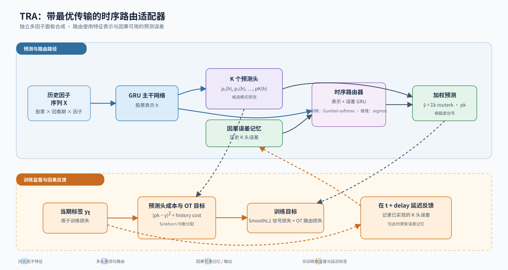

# Temporal Routing Adaptor Alpha Model

## Architecture




`skill-factor-model-tra` is a standalone, installable TRA model for synthesising a user-supplied multi-factor panel into cross-sectional stock signals. It combines multiple prediction heads, causal error memory, and optimal-transport routing.

## Capabilities

- Loads CSV or Parquet multi-factor panels.
- Encodes historical factor sequences with a GRU backbone.
- Routes samples among multiple prediction heads.
- Delays error-memory updates until labels are configured to be available.
- Uses Sinkhorn optimal transport as auxiliary routing supervision.
- Selects checkpoints by validation mean Pearson IC and exports `date,ticker,signal` files.

## Quick start

```bash
python -m pip install -e ".[test]"
python examples/make_synthetic_panel.py   --output examples/generated/synthetic_panel.csv
python scripts/run_model.py check --config examples/smoke.yaml
python scripts/run_model.py train --config examples/smoke.yaml
```

Then export and verify a test split:

```bash
python scripts/run_model.py predict   --run-dir outputs/smoke/<run_id> --split test
python scripts/run_model.py verify   --run-dir outputs/smoke/<run_id>
```

Run the synthetic smoke flow and unit tests with:

```bash
python scripts/run_smoke.py
python -m pytest -q
```

## Input and output

The input is one long-form CSV or Parquet panel with unique `(date, ticker)` rows. Declare numeric factor columns, the label column, chronological splits, and label-availability delay explicitly in YAML. See the [input contract](references/input_contract.md).

A completed run writes a resolved configuration, input manifest, epoch metrics, selected checkpoint, validation summary, and optional signal export. Signal files always contain:

```text
date,ticker,signal
20250102,600000,0.1837
```

See the [output contract](references/output_contract.md) for the full artifact definition.

## Method and paper reference

This project is informed by:

> Hengxu Lin, Dong Zhou, Weiqing Liu, Jiang Bian. **Learning Multiple Stock Trading Patterns with Temporal Routing Adaptor and Optimal Transport.** KDD 2021. DOI: [10.1145/3447548.3467358](https://doi.org/10.1145/3447548.3467358).

This repository is an **unofficial independent reproduction and generic factor-panel adaptation**, not an implementation released by the paper authors or Microsoft Qlib. It retains multiple prediction heads, representation-plus-error routing, Gumbel routing, and Sinkhorn OT supervision while leaving the backbone, labels, data panel, and training parameters configurable. See [method mapping](references/method_mapping.md).

Public paper: [arXiv](https://arxiv.org/abs/2106.12950). Reference implementation directory: [Qlib TRA](https://github.com/microsoft/qlib/tree/main/examples/benchmarks/TRA).

## Research use

**Data source:** users supply factor panels and labels at runtime; the repository contains only synthetic examples. **Assumptions and parameters:** splits, label availability, lookback, expert count, and optimal-transport settings are explicit YAML parameters. **Limitations and risk boundary:** output is a cross-sectional ranking signal, not portfolio construction, execution, or a return guarantee. This project is for research and education and does not constitute investment advice.

## License

Licensed under [GPL-3.0-only](LICENSE).
